<div align="center">

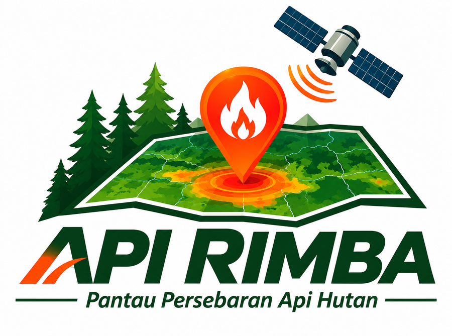

# ApiRimba AI

**Lihat ke mana api menjalar, sebelum api sampai.**

Prediksi sebaran kebakaran hutan dan lahan gambut 12 jam ke depan, rekomendasi sekat bakar, lapor api oleh warga, dan penyaluran bantuan ke posko, dalam satu aplikasi web.

[**Buka aplikasi**](https://apirimba-ai.vercel.app) · [Peta langsung](https://apirimba-ai.vercel.app/peta) · [Contoh simulasi](https://apirimba-ai.vercel.app/peta?scenario=riau&sekat=1) · [Masuk sebagai demo](https://apirimba-ai.vercel.app/masuk)


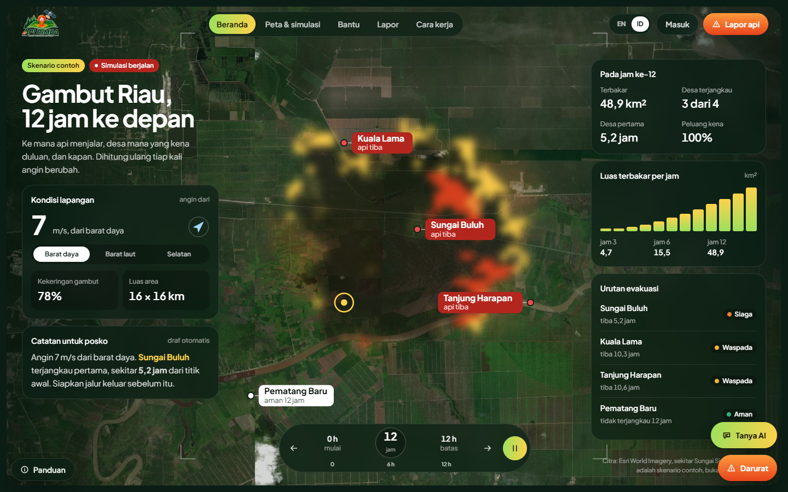

</div>

> Karya kompetisi Web Development **IT RUSH 2026**, tema **AI Teknologi untuk Penguatan Masyarakat serta Keberlanjutan Pesisir dan Hutan Tropis**.
> Hasil aplikasi adalah prediksi simulasi untuk dukungan keputusan, bukan pengganti penilaian di lapangan.

---

## Daftar isi

- [Kenapa ApiRimba](#kenapa-apirimba)
- [Kesesuaian dengan tema](#kesesuaian-dengan-tema)
- [Tampilan](#tampilan)
- [Fitur](#fitur)
- [Akun dan akun demo](#akun-dan-akun-demo)
- [Arsitektur](#arsitektur)
- [Routing](#routing)
- [Database](#database)
- [Keamanan](#keamanan)
- [Peran AI](#peran-ai)
- [Menjalankan secara lokal](#menjalankan-secara-lokal)
- [Deploy (gratis)](#deploy-gratis)
- [Model dan batasan](#model-dan-batasan)
- [Penggunaan AI coding assistant, template, dan aset](#penggunaan-ai-coding-assistant-template-dan-aset)

## Kenapa ApiRimba

Titik panas satelit hanya memberi tahu di mana api **sekarang**. Regu pemadam, kepala desa, dan warga butuh jawaban untuk beberapa jam ke depan:

- **Ke mana api menjalar?** Angin yang bergeser sedikit bisa membelokkan api ke desa dalam hitungan jam.
- **Desa mana yang kena duluan, dan kapan?** Urutan evakuasi bergantung pada jam tiba api.
- **Di mana sekat bakar paling efektif?** Selama ini lokasinya dipilih dari pengalaman, tanpa bisa diuji dulu. Di gambut kering, api bahkan bisa merambat di bawah sekat yang dangkal.

ApiRimba menjawab ketiganya dari data terbuka, lalu menghubungkan warga, posko, dan donatur dalam satu alur.

## Kesesuaian dengan tema

| Unsur tema | Wujud di ApiRimba |
| --- | --- |
| **Hutan tropis** | Simulasi sebaran api di hutan dan lahan gambut tropis Riau, Kalimantan Tengah, dan Sumatera Selatan, serta di titik panas mana pun di Indonesia. Tiap simulasi memperkirakan **potensi CO₂ yang dilepas** dan **berapa ton yang dicegah sekat bakar** (faktor emisi bawaan IPCC). |
| **Pesisir** | Sebagian besar gambut di ketiga provinsi itu ada di **dataran rendah pesisir**, dekat desa nelayan, muara, dan pelabuhan. Asap dari satu kebakaran bisa menutup pelabuhan dan membuat perahu tidak melaut. |
| **Penguatan masyarakat** | Warga **melapor api dengan foto tanpa perlu akun**. Tiap desa mendapat **jam tiba api dan level** (Aman, Waspada, Siaga, Awas). Donatur **menjanjikan bantuan dan melacaknya** sampai disalurkan. Posko memverifikasi laporan warga lewat dasbor petugas. |
| **AI** | Gemini menyusun briefing dan prioritas tindakan, memeriksa foto laporan warga, dan menjadi asisten tanya-jawab. Sekat bakar dipilih lewat pencarian berbasis simulasi Monte Carlo. Lihat [Peran AI](#peran-ai). |
| **SDG** | 11 Komunitas tangguh · 13 Aksi iklim · 15 Ekosistem daratan |

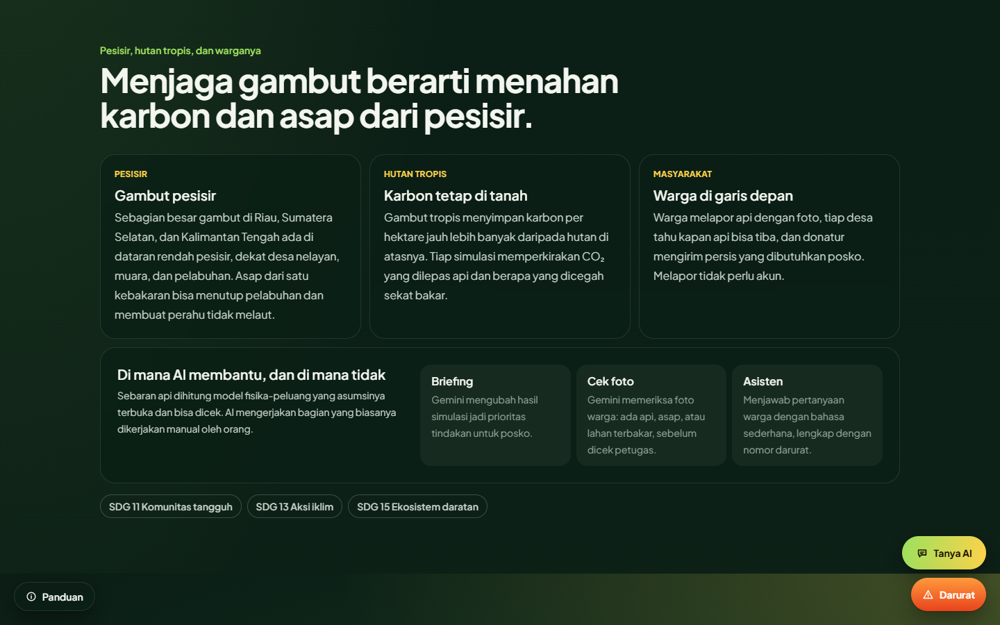

## Tampilan

### Peta titik panas nasional

Semua titik panas NASA FIRMS di Indonesia (24 sampai 72 jam terakhir), dikelompokkan jadi kejadian dan diurutkan prioritasnya. Klik satu titik untuk melihat angin, kualitas udara, sumber air, dan layanan darurat terdekat, lalu jalankan simulasi di lokasi itu.

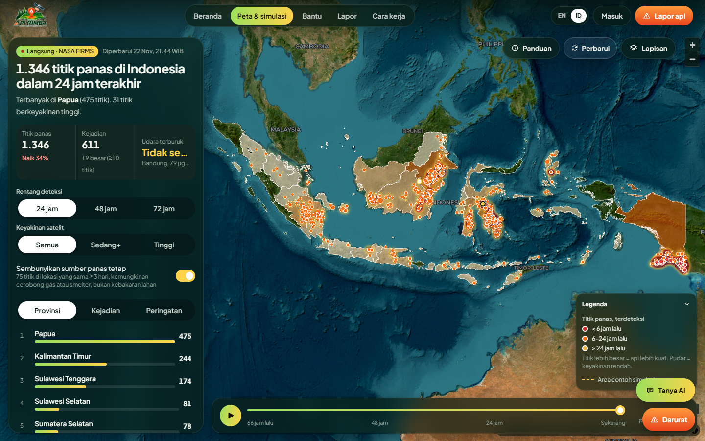

### Simulasi 12 jam dan sekat bakar

Peta sebaran api per 15 menit, jam tiba di tiap desa, tiga rekomendasi sekat bakar lengkap dengan koordinat ujungnya, dan potensi CO₂ yang bisa dicegah.

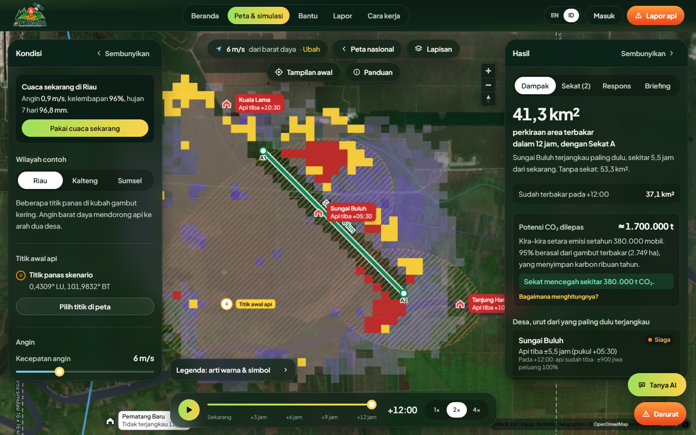

### Laporan siap cetak untuk posko

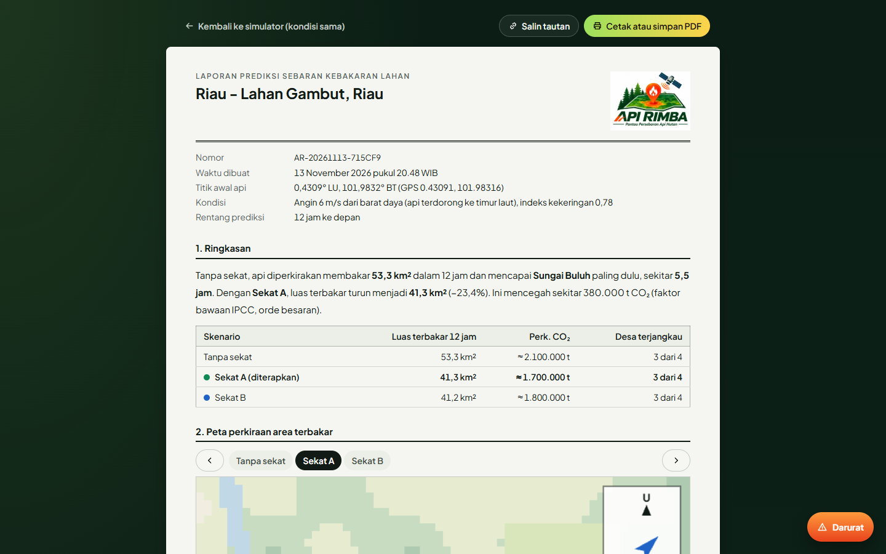

### Lapor api, bantu posko, dan masuk

| Lapor api | Bantu posko |
| --- | --- |
| 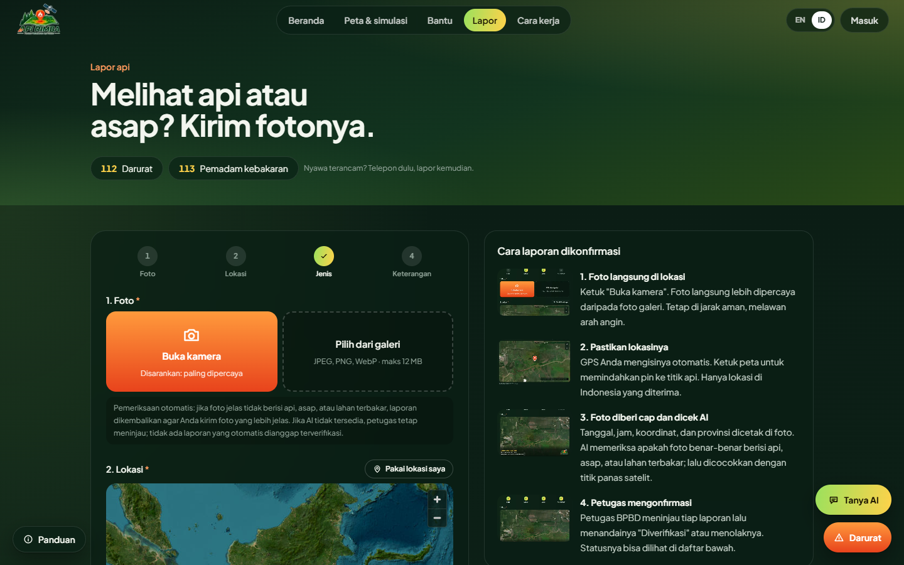 | 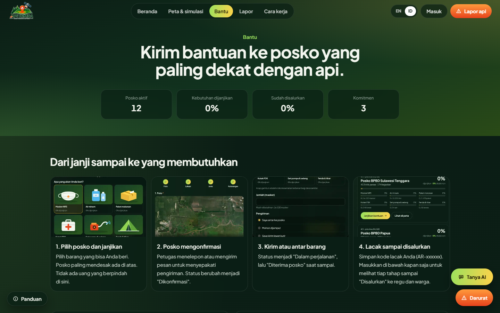 |

| Masuk dan akun demo | Cara kerja |
| --- | --- |
| 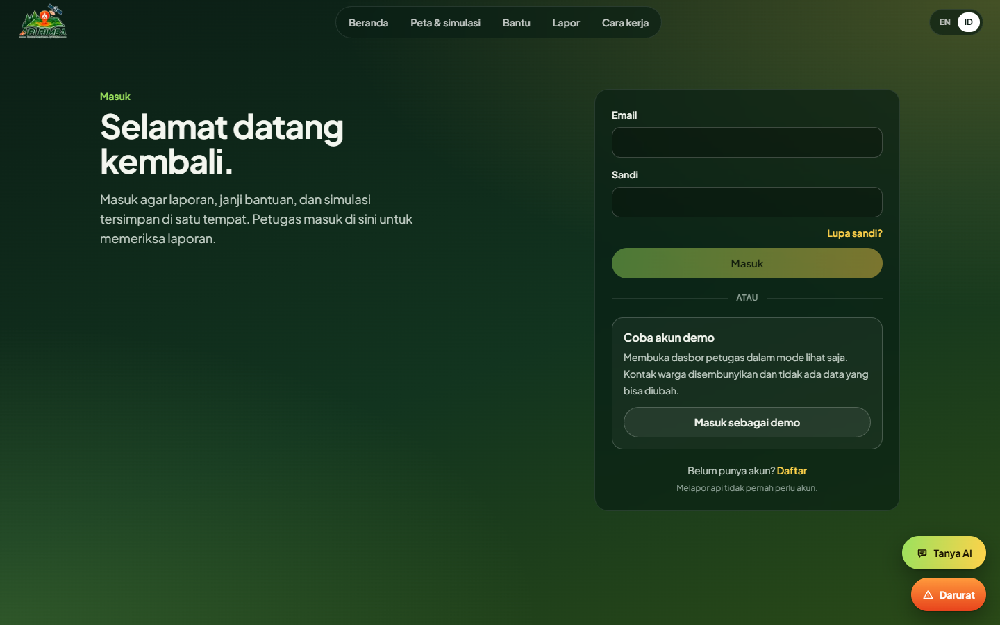 | 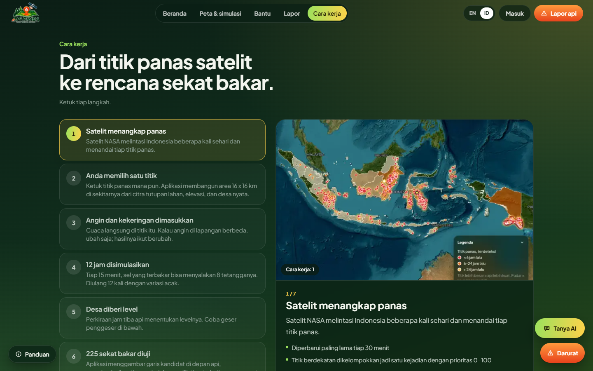 |

### Di ponsel

<p>
  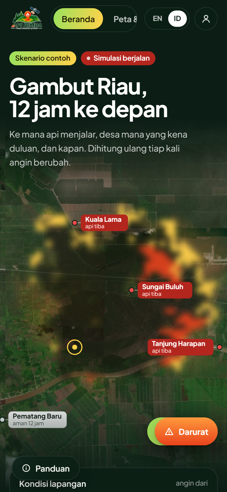
  &nbsp;
  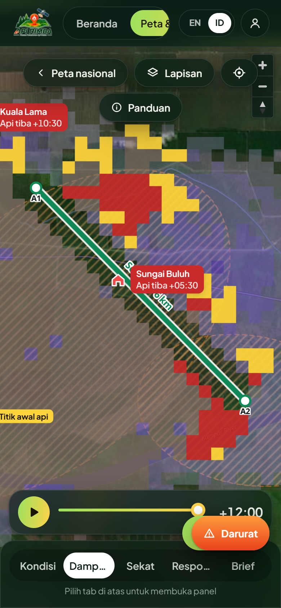
</p>

## Fitur

| Fitur | Keterangan |
| --- | --- |
| Peta titik panas nasional | NASA FIRMS langsung, dikelompokkan jadi kejadian dengan skor prioritas 0-100. Sumber panas tetap (cerobong, smelter) bisa disembunyikan. |
| Simulasi sebaran 12 jam | Grid 64 x 64 sel (250 m), langkah 15 menit, 12 run Monte Carlo di Web Worker. Bisa di skenario contoh atau area 16 x 16 km di sekitar titik panas nyata. |
| Kontrol angin dan cuaca | Kecepatan, arah, dan kekeringan; cuaca terkini dari Open-Meteo bisa dipakai dengan satu ketukan. |
| Rekomendasi sekat bakar | Menguji ratusan kandidat garis sekat dengan simulasi ulang, lalu memilih tiga terbaik berdasarkan penurunan luas terbakar dan waktu yang cukup untuk membangunnya. |
| Potensi emisi CO₂ | Per jenis lahan dengan faktor bawaan IPCC, plus CO₂ yang dicegah oleh sekat. |
| Jam tiba di desa | Level Aman, Waspada, Siaga, Awas dan urutan evakuasi. |
| Rencana respons dan briefing AI | Penempatan regu dan aset, lalu Gemini menyusun prioritas tindakan untuk posko. |
| Lapor api | Foto wajib, diberi cap tanggal dan lokasi, diperiksa AI, dicocokkan dengan titik panas satelit dan GPS foto. Tanpa akun. |
| Bantu posko | Janji bantuan (masker, air, makanan, P3K, peralatan, tenda) dengan kode lacak sampai disalurkan. Tidak ada uang yang berpindah. |
| Dasbor petugas | Verifikasi laporan warga dan perbarui status bantuan. |
| Akun | Daftar, masuk, lupa sandi, halaman akun berisi laporan, bantuan, dan simulasi milik sendiri. |
| Dua bahasa | Indonesia dan Inggris, plus asisten AI dan tombol darurat (112, 113, 119) di tiap halaman. |

## Akun dan akun demo

| Peran | Bisa apa |
| --- | --- |
| Tamu | Semua halaman publik: peta, simulasi, lapor api, bantu, cara kerja. |
| Warga | Seperti tamu, ditambah halaman **Akun** berisi laporan, janji bantuan, dan simulasi miliknya. |
| Petugas | Dasbor `/petugas`: verifikasi laporan warga, ubah status penyaluran bantuan. |
| Admin | Seperti petugas, ditambah **Kelola akun** untuk memberi atau mencabut peran petugas. |
| Demo | Dasbor petugas dalam mode **lihat saja**. Nama warga disingkat, kontak disembunyikan, tombol aksi mati, dan basis data menolak semua perubahan. |

**Untuk juri:** buka [`/masuk`](https://apirimba-ai.vercel.app/masuk) lalu tekan **Masuk sebagai demo**. Tidak perlu email atau sandi: kredensial demo disimpan di server dan tidak pernah dikirim ke peramban.

Melapor api **tidak pernah** memerlukan akun, karena dalam keadaan darurat login tidak boleh menjadi penghalang.

## Arsitektur

Frontend, backend, dan database dipisah per lapisan, tetapi frontend dan backend berada dalam satu proyek Next.js agar cukup satu deploy gratis di Vercel.

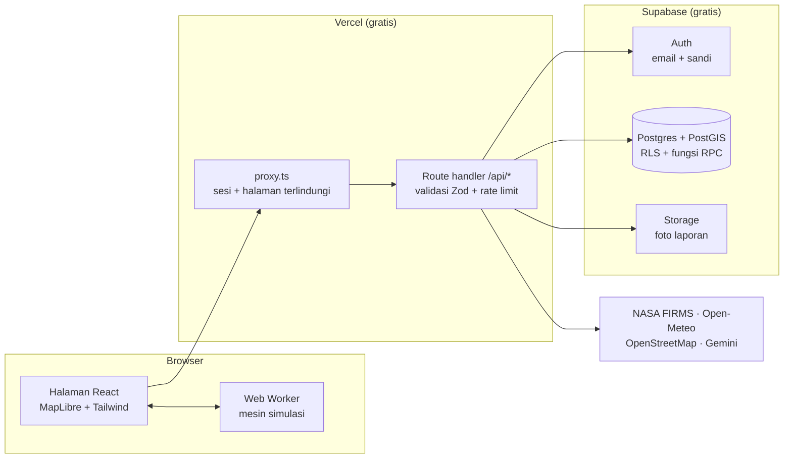

| Lapisan | Teknologi |
| --- | --- |
| Frontend | Next.js 16 (App Router), React 19, TypeScript strict, Tailwind CSS 4, MapLibre GL JS 6, Zustand, Recharts |
| Simulasi | TypeScript murni di Web Worker (Comlink), tanpa DOM |
| Backend | Route handler Next.js di Vercel Functions, `src/proxy.ts`, validasi Zod |
| Database | Supabase Postgres + PostGIS, Row Level Security, fungsi RPC `security definer` |
| Auth | Supabase Auth (email + sandi) lewat `@supabase/ssr`, sesi di cookie |
| AI | Google Gemini (briefing, cek foto, asisten) |
| Data | NASA FIRMS, Open-Meteo, OpenStreetMap (Overpass dan Nominatim), citra Esri |
| Pengujian | Vitest (56 tes) |

## Routing

### Halaman

| Rute | Akses | Isi |
| --- | --- | --- |
| `/` | Publik | Beranda, simulasi contoh, tema, cara pakai |
| `/peta` | Publik | Peta titik panas nasional |
| `/peta?lokasi=lat,lon` | Publik | Simulasi di titik panas nyata |
| `/peta?scenario=riau&sekat=1` | Publik | Simulasi skenario contoh dengan sekat A |
| `/report/[id]` | Publik (dengan tautan) | Laporan simulasi siap cetak |
| `/lapor` | Publik | Lapor api dengan foto |
| `/bantu` | Publik | Kebutuhan posko, janji bantuan, lacak kode |
| `/cara-kerja` | Publik | Model, data, dan batasan |
| `/masuk`, `/daftar` | Publik | Masuk (termasuk akun demo) dan daftar |
| `/lupa-sandi`, `/atur-sandi` | Publik | Atur ulang sandi lewat email |
| `/auth/callback` | Publik | Tujuan tautan konfirmasi dari email |
| `/akun` | Wajib masuk | Profil, laporan, bantuan, simulasi milik sendiri; kelola akun (admin) |
| `/petugas` | Wajib masuk, peran petugas/admin/demo | Dasbor verifikasi |

### API

| Rute | Metode | Akses | Fungsi |
| --- | --- | --- | --- |
| `/api/pantau/hotspots`, `/api/pantau/cuaca` | GET | Publik | Titik panas dan cuaca nasional |
| `/api/hotspots`, `/api/weather` | GET | Publik | Titik panas dan cuaca per area simulasi |
| `/api/area/provinsi`, `/api/area/desa`, `/api/area/landcover` | GET | Publik | Batas wilayah, desa, tutupan lahan |
| `/api/bantuan` | GET | Publik | Sumber air dan layanan darurat terdekat |
| `/api/simulations`, `/api/simulations/[id]` | POST, GET | Publik, dibatasi laju | Simpan dan buka laporan simulasi |
| `/api/briefing` | POST | Publik, dibatasi laju | Briefing AI |
| `/api/chat` | POST | Publik, dibatasi laju | Asisten AI |
| `/api/lapor` | GET, POST | Publik, dibatasi laju | Daftar laporan publik, kirim laporan |
| `/api/bantu`, `/api/bantu/lacak` | GET, POST | Publik, dibatasi laju | Kebutuhan posko, janji bantuan, lacak |
| `/api/auth/me` | GET | Publik | Status akun saat ini |
| `/api/auth/demo` | POST | Publik, dibatasi laju | Masuk sebagai akun demo |
| `/api/auth/signout` | POST | Masuk | Keluar |
| `/api/petugas` | GET, POST | Petugas/admin (demo: GET saja) | Data dasbor, verifikasi, status bantuan |
| `/api/admin/users` | GET, POST | Admin | Daftar akun, ubah peran |
| `/api/health` | GET | Publik | Cek kesehatan; dipanggil cron harian |

## Database

Migrasi ada di [`supabase/migrations/`](supabase/migrations) dan dijalankan berurutan.

| Migrasi | Isi |
| --- | --- |
| `0001_init` | Skenario, zona gambut, desa, titik panas, cuaca, simulasi, rekomendasi sekat, risiko desa, peringatan |
| `0002_rls` | RLS di semua tabel; data referensi hanya bisa dibaca |
| `0003_rpc` | `save_simulation` dan `get_simulation` |
| `0004_reports_aid` | Laporan warga, janji bantuan, bucket foto |
| `0005_review_tracking` | Hasil cek AI, verifikasi petugas, pelacakan bantuan (kode `AR-xxxxxx`) |
| `0006_duplicate_and_notifications` | Tolak foto kembar di lokasi yang sama dalam 24 jam |
| `0007_auth_roles` | Tabel `profiles` dan peran, kepemilikan data (`user_id`), fungsi `staff_*` dan `admin_*`, pembatas laju `rate_hit`, mematikan PIN petugas lama |
| `0008_revoke_anon` | Mencabut izin bawaan `anon` atas fungsi staf, admin, dan profil |

## Keamanan

- **Row Level Security di semua tabel.** Klien tidak bisa menulis langsung ke tabel; semua penulisan lewat fungsi RPC yang memvalidasi isi. Pengguna hanya bisa membaca laporan, bantuan, dan simulasi miliknya sendiri (`user_id = auth.uid()`).
- **Peran diperiksa dua kali**, di route handler dan di dalam fungsi basis data. Peran tidak bisa diubah pengguna sendiri; hanya admin, dan admin tidak bisa mengubah perannya sendiri atau akun demo.
- **Sesi di cookie** (`@supabase/ssr`) disegarkan di `src/proxy.ts`. Identitas di server selalu diverifikasi ke Supabase Auth (`getUser`), bukan sekadar membaca cookie.
- **Rahasia hanya di server:** `GEMINI_API_KEY`, `FIRMS_MAP_KEY`, `DEMO_PASSWORD`, `RATE_LIMIT_SALT`. Hanya URL dan publishable key Supabase yang publik, dan keduanya dibatasi RLS. Tidak ada service role key di aplikasi.
- **Pembatas laju per IP** untuk lapor, bantu, chat, briefing, simulasi, dan login demo. IP disimpan sebagai hash bergaram.
- **Validasi input** dengan Zod. Foto diperiksa dari byte awalnya (bukan nama file), dibatasi 8 MB, diberi watermark, dan ditolak bila foto yang sama dilaporkan ulang di lokasi yang sama.
- **Privasi:** daftar laporan publik tidak memuat kontak, dan nama pelapor hanya inisial. Akun demo tidak pernah melihat kontak warga.
- **Pengaman open redirect** pada parameter `?next=` (`src/lib/safe-next.ts`, dites).
- **Header keamanan:** CSP `frame-ancestors 'none'`, HSTS, `X-Frame-Options`, `X-Content-Type-Options`, `Referrer-Policy`, `Permissions-Policy`.
- **Pesan galat login** tidak membocorkan apakah sebuah email terdaftar.

## Peran AI

Kami memisahkan dengan jelas bagian yang dikerjakan AI dan bagian yang dihitung model, supaya hasilnya bisa dipercaya dan diperiksa.

| Bagian | Cara kerja |
| --- | --- |
| **Rekomendasi sekat bakar** | Pencarian berbasis simulasi: kandidat garis sekat dibangkitkan tegak lurus arah sebaran (variasi jarak, rotasi, panjang, dan geser), kandidat yang tidak sempat dibangun sebelum api tiba dibuang, sisanya dievaluasi dengan simulasi ulang, lalu dipilih tiga yang terbaik dan saling berjauhan. |
| **Briefing (Gemini)** | Ringkasan simulasi (angin, luas, desa, sekat) diubah jadi briefing situasi dan prioritas tindakan untuk posko. Bila Gemini tidak tersedia, dipakai briefing cadangan berbasis aturan. |
| **Cek foto laporan (Gemini)** | Foto warga diperiksa: ada api, asap, atau lahan terbakar. Foto yang jelas bukan kebakaran ditolak; sisanya dicocokkan dengan titik panas satelit dan GPS foto, lalu dicek petugas. |
| **Asisten (Gemini)** | Menjawab pertanyaan warga dengan bahasa sederhana, lengkap dengan nomor darurat. |
| **Sebaran api** | **Bukan** AI: model fisika-peluang (cellular automata + Monte Carlo) yang asumsinya terbuka. Lihat [Model dan batasan](#model-dan-batasan). |

## Menjalankan secara lokal

Prasyarat: Node.js 20 atau lebih baru, dan proyek Supabase (paket gratis cukup).

```bash
npm install
cp .env.local.example .env.local   # isi variabel di bawah
npm run dev                         # http://localhost:3000
```

| Perintah | Fungsi |
| --- | --- |
| `npm test` | 56 tes unit (mesin simulasi, sekat, emisi, auth) |
| `npm run lint` | ESLint |
| `npm run build && npm start` | Build dan jalankan versi produksi |
| `npm run build:data` | Buat ulang data skenario dan `supabase/seed.sql` |

### Variabel lingkungan

| Variabel | Sisi | Keterangan |
| --- | --- | --- |
| `NEXT_PUBLIC_SUPABASE_URL` | Publik | URL proyek Supabase |
| `NEXT_PUBLIC_SUPABASE_PUBLISHABLE_KEY` | Publik | Publishable key (dibatasi RLS) |
| `GEMINI_API_KEY` | Server | Kunci Google AI Studio (opsional, ada cadangan) |
| `GEMINI_MODEL` | Server | Default `gemini-flash-lite-latest` |
| `FIRMS_MAP_KEY` | Server | MAP_KEY NASA FIRMS (opsional, ada data cadangan) |
| `DEMO_EMAIL`, `DEMO_PASSWORD` | Server | Akun demo hanya-baca |
| `RATE_LIMIT_SALT` | Server | String acak untuk hash IP |
| `NEXT_PUBLIC_MAP_STYLE_DARK` / `_LIGHT` | Publik | Gaya peta dasar (opsional) |

### Menyiapkan Supabase

1. Jalankan migrasi `0001` sampai `0008`, lalu `seed.sql`, lewat SQL Editor atau Supabase CLI.
2. Buat akun demo: daftarkan email `DEMO_EMAIL` dengan sandi `DEMO_PASSWORD`, lalu jadikan perannya demo:
   ```sql
   update profiles set role = 'demo' where id = (select id from auth.users where email = 'demo@apirimba.app');
   ```
3. Jadikan akun Anda admin setelah mendaftar:
   ```sql
   update profiles set role = 'admin' where id = (select id from auth.users where email = '<email-anda>');
   ```
4. Di **Authentication**:
   - **URL Configuration:** isi Site URL dengan domain Anda, lalu tambahkan `https://<domain>/auth/callback` ke Redirect URLs.
   - **Providers, Email:** layanan email bawaan Supabase hanya mengirim ke anggota tim proyek. Matikan **Confirm email**, atau pasang SMTP sendiri (misalnya Resend, gratis).

## Deploy (gratis)

| Layanan | Paket | Catatan |
| --- | --- | --- |
| Vercel | Hobby | Frontend dan backend dalam satu proyek. Cron harian ke `/api/health` (`vercel.json`). |
| Supabase | Free | Database 500 MB, storage 1 GB, Auth 50.000 pengguna aktif per bulan. Proyek gratis dijeda setelah 7 hari tanpa aktivitas; cron harian mencegahnya. |

```bash
vercel env add DEMO_PASSWORD production --sensitive   # ulangi untuk tiap variabel server
vercel deploy --prod
```

## Model dan batasan

- Peluang api menjalar ke sel tetangga per langkah: `p = min(0,95; p0 x f_bahan x f_angin x f_lereng x f_kering x f_jarak)` dengan `f_angin = e^(c1 V) x e^(c2 V (cos φ - 1))`, terinspirasi Alexandridis dkk. (2008).
- Simulasi dihitung sebagai waktu tunda per jalur sel ke sel dengan keacakan ber-seed per jalur, sehingga dua simulasi dengan seed sama bisa dibandingkan secara adil (efek sekat tidak tertutup noise).
- Gambut kering menyala lebih lama (fase membara) dan bisa menembus sekat permukaan.
- Parameter (`src/lib/sim/params.ts`) ditala secara visual, **belum dikalibrasi** dengan data kebakaran historis. Jam tiba adalah perkiraan kasar.
- Angin dianggap seragam selama 12 jam. Api di luar kotak 16 x 16 km tidak dihitung.
- Tutupan lahan, gambut, sungai, dan desa pada tiga skenario contoh adalah ilustrasi; nama desa fiktif. Area langsung dibangun dari citra dan OpenStreetMap, dengan gambut diperkirakan.
- **Emisi CO₂** = luas terbakar per jenis lahan x faktor bawaan IPCC: gambut 600 t CO₂/ha (IPCC 2013 Wetlands Supplement), hutan primer 133, hutan sekunder dan perkebunan 67, semak 43, lahan terbuka 10 t CO₂/ha (IPCC 2006). Hanya CO₂, metana belum dihitung. Ini potensi bila gambut membara sampai habis, yang biasanya butuh berhari-hari; angkanya orde besaran, bukan inventarisasi resmi.

## Struktur proyek

```text
src/
  app/                halaman dan route handler /api/*
  components/         auth, map, pantau, simulator, response, report, lapor, bantu, petugas, ui
  lib/sim/            mesin simulasi murni TypeScript (engine, firebreak, risk, carbon)
  lib/supabase/       klien Supabase untuk server (bersesi) dan browser
  lib/data/           NASA FIRMS, Open-Meteo, data cadangan
  proxy.ts            penyegar sesi dan penjaga halaman terlindungi
  workers/            Web Worker simulasi
supabase/migrations/  skema, RLS, RPC, auth dan peran
tests/unit/           tes Vitest
docs/                 dokumen rancangan dan screenshots/
```

## Penggunaan AI coding assistant, template, dan aset

Sesuai ketentuan IT RUSH 2026:

- **AI coding assistant:** dikembangkan dengan bantuan **Claude Code (Anthropic)** untuk penulisan kode, pengujian, dan dokumentasi, di bawah arahan dan peninjauan tim.
- **Template:** kerangka awal dari `create-next-app`.
- **Library open-source:** Next.js, React, Tailwind CSS, MapLibre GL JS, Zustand, Comlink, Zod, Supabase JS dan SSR, Turf.js, date-fns, Recharts, qrcode, Vitest.
- **Layanan dan data:** NASA FIRMS, Open-Meteo, OpenStreetMap contributors, citra Esri World Imagery, CARTO basemaps, Google Gemini API, Supabase, Vercel. Faktor emisi dari IPCC 2006 Guidelines dan IPCC 2013 Wetlands Supplement.
- **Aset visual:** logo dan ilustrasi dibuat sendiri.

## Tim

**Belva & Salma**
